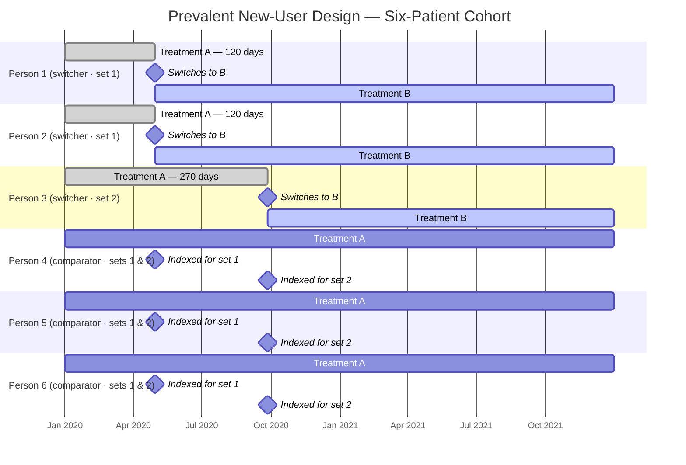

# PrevalentNewUser

**Prevalent New-User Cohort Design for OMOP CDM Data**

[](https://opensource.org/licenses/Apache-2.0)
[](https://lifecycle.r-lib.org/articles/stages.html#experimental)
[](https://ohdsi.github.io/Hades/)

---

## Overview

`PrevalentNewUser` is an R package that implements the **prevalent new-user (PNU) cohort design** for observational studies using data mapped to the [OMOP Common Data Model](https://ohdsi.github.io/CommonDataModel/).

The PNU design, introduced by Suissa, Moodie & Dell'Aniello (2017), extends the classic active-comparator new-user (ACNU) design to situations where the **comparator group has already been on the reference treatment** when the index date is defined. This is common in pharmacoepidemiology: you want to compare patients who *switch* from drug A to drug B against patients who *stay* on drug A, conditioning on how long each group had been on A before the switch.

`PrevalentNewUser` sits alongside [CohortMethod](https://github.com/OHDSI/CohortMethod), which implements the ACNU design. A PNU analysis restricted to patients with *no* prior reference treatment (exposure set 0) is mathematically equivalent to an ACNU analysis and should reproduce CohortMethod results.

---

## The Prevalent New-User Design

| Concept | Meaning |
|---|---|
| **Reference treatment (A)** | The treatment patients are already on (e.g. GLP-1 RA) |
| **New treatment (B)** | The treatment some patients switch to (e.g. bariatric surgery) |
| **Switcher (target)** | A person who starts B; their B start date is the index date |
| **Exposure set** | Switchers who had the same duration on A at their index date, plus eligible comparators |
| **Comparator** | A person still on A, indexed on the day they had been on A as long as a matched switcher |
| **TCPS** | Time-conditional propensity score — P(switch) given covariates, estimated by conditional logistic regression stratified by exposure set |
| **Matched set** | One switcher + matched comparators within one exposure set; the stratum for the outcome model |

The key insight is that matching **within exposure sets** removes confounding by duration of prior treatment. Persons who have been on A for one month differ systematically from those who have been on A for two years, so the comparison must be made at the same point in the treatment history.

---

## Six-Patient Illustration

The diagram below shows the six-patient example used throughout the package's tests. Persons 1–3 switch from treatment A to treatment B; persons 4–6 remain on A and serve as comparators.



**Key observations:**

- Persons 1 and 2 switch after **120 days** on A → they form **exposure set 1** (index date: 30 Apr 2020).
- Person 3 switches after **270 days** on A → **exposure set 2** (index date: 27 Sep 2020).
- Persons 4–6 never switch. They can be comparators in **both** sets: they are indexed at 30 Apr 2020 for set 1 (when they had also been on A for 120 days) and again at 27 Sep 2020 for set 2 (270 days on A). A person can appear as a comparator in multiple exposure sets.
- The time-conditional propensity score (TCPS) is estimated by **conditional logistic regression stratified by exposure set**, so only persons within the same set are compared when estimating P(switch).

---

## Installation

`PrevalentNewUser` is not yet on CRAN. Install from GitHub:

```r
# install.packages("remotes")
remotes::install_github("OHDSI/PrevalentNewUser")
```

### System requirements

The package uses the standard OHDSI HADES stack. You will need:

- R ≥ 4.2
- Java (for DatabaseConnector / SqlRender)
- A database connector supported by DatabaseConnector (SQL Server, PostgreSQL, RedShift, Oracle, Snowflake, Spark, BigQuery, or SQLite via Eunomia for testing)

---

## Quick Start

```r
library(PrevalentNewUser)

# 1. Describe the cohorts and study options
cohortArgs <- createPnuCohortArgs(
  targetCohortId     = 1,   # treatment A cohort
  comparatorCohortId = 2,   # treatment B / switcher cohort
  outcomeCohortId    = 3,   # outcome cohort
  washoutPeriod      = 365  # days of prior observation required
)

# 2. Connect to your CDM
connectionDetails <- DatabaseConnector::createConnectionDetails(
  dbms     = "postgresql",
  server   = "myserver/mydb",
  user     = "user",
  password = "password"
)

# 3. Pull data (including covariates and exposure sets)
covariateSettings <- FeatureExtraction::createDefaultCovariateSettings()

pnuData <- getDbPnuData(
  connectionDetails    = connectionDetails,
  cdmDatabaseSchema    = "cdm",
  cohortDatabaseSchema = "results",
  cohortTable          = "cohort",
  pnuCohortArgs        = cohortArgs,
  covariateSettings    = covariateSettings
)

# 4. Build the study population
studyPop <- createStudyPopulation(
  pnuData              = pnuData,
  studyPopulationArgs  = createStudyPopulationArgs(
    outcomeId        = 3,
    riskWindowStart  = 0,
    riskWindowEnd    = 365,
    endAnchor        = "cohort start"
  )
)

# 5. Fit TCPS, match, and estimate
tcpsFit <- fitTcps(studyPop, pnuData, createTcpsArgs())
matched  <- matchOnTcps(tcpsFit, createMatchingArgs(maxRatio = 4))
result   <- fitOutcomeModel(matched, pnuData, createOutcomeModelArgs())

result$logRr
result$ci95Lb
result$ci95Ub
```

> **Note:** The functions used after `createPnuCohortArgs()` are implemented in later development phases. See `extras/ImplementationPlan.md` for current status.

---

## Relationship to CohortMethod

| Feature | CohortMethod | PrevalentNewUser |
|---|---|---|
| Design | Active-comparator new-user (ACNU) | Prevalent new-user (PNU) |
| Prior treatment required? | No | Yes (treatment A) |
| Propensity score | Standard PS (unconditional logistic) | TCPS (conditional logistic, stratified by exposure set) |
| Exposure set 0 result | Native | Equivalent to CohortMethod (tested) |
| Runtime dependency on the other | — | No |

---

## References

Suissa S, Moodie EE, Dell'Aniello S. Prevalent new-user cohort designs for comparative drug effect studies by time-conditional propensity scores. *Pharmacoepidemiology and Drug Safety* 2017;**26**(4):459–468. [doi:10.1002/pds.4117](https://doi.org/10.1002/pds.4117)

---

## License

Copyright 2026 Observational Health Data Sciences and Informatics

Licensed under the Apache License, Version 2.0. See [LICENSE](LICENSE) for details.
